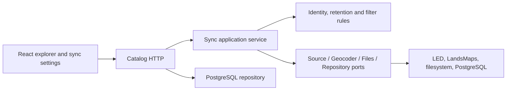

# Architecture

The local application separates domain rules, application workflow, infrastructure adapters, and HTTP presentation. React uses only the HTTP API.

`createSyncService` receives repository, source, geocoder, files, geography and an injectable clock. It owns the single-job lock, scheduled runs, scope queue, background source verification, cancellation, progress, source errors and retention. Restarted work is marked interrupted; a new run safely upserts records again.

The LED adapter owns form preparation, pagination, red-row exclusion and detail extraction. The sync form has only geographical values; display filters never reach the adapter. A stable identity uses source sale lot, asset sequence, case and province. It deliberately distinguishes a new sale lot from a repeated fetch of the same listing.

PostgreSQL stores source JSON separately from user JSON. Upsert never writes user JSON on conflict. A per-run ledger records first/last seen and increments once per sync run, despite multiple progress callbacks. Superseded and expired evidence enters a durable file-GC queue in the same transaction as the data change. Only unreferenced allowlisted files within the evidence directory can be removed; failed deletions remain queued.

Retention uses the Bangkok calendar date and one calendar month after the latest valid auction date. Unknown/invalid schedules are retained. Manual protection always overrides expiry. Other exceptions come from saved settings.

LandsMaps returns coordinates and two evidence views after a bounded tile-loading wait. Facebook provides date-matched full images from visible public posts; it never claims row recognition or changes user auction status. Those adapters surface loading failures separately from genuine missing results.

The LandsMaps adapter inspects the response to its normal browser form submission because the source renders a misleading not-found dialog for an HTTP 200 quota error. A domain `SourceRateLimitError` pauses the application queue for 302 minutes. `geoRetryAt` survives restart and is independent of the weekly LED schedule. Only exact geographic/deed matches reuse previously verified parcel evidence; no direct authenticated API calls or quota bypass is used.

HTTP writes require an application header and a recognized local origin. The composition root listens only on loopback and starts the scheduler. Credentials, retrieved records, evidence and build output stay out of Git. Reference geography is public, versioned data; a local cache can replace it without making the UI dependent on a live source form.

Unit tests cover boundaries and application ports. Database smoke verification checks actual upsert and annotation preservation. Live adapter smoke tests are explicit and excluded from CI.
