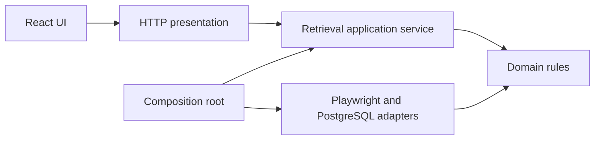

# Architecture

The local application follows Clean Architecture boundaries without adding a framework or dependency injection container.

`createRetrievalService` receives four ports:

| Port       | Responsibility                                                                                             |
| ---------- | ---------------------------------------------------------------------------------------------------------- |
| repository | Persist and load retrieval snapshots.                                                                      |
| source     | Prepare source filters; extract all result pages and emit progress snapshots.                              |
| geocoder   | Resolve a deed using province and district, returning coordinates and evidence or a missing-result status. |
| workspace  | Serialize browser operations and prevent simultaneous jobs from sharing the same source form.              |

The application service manages job lifecycle, cancellation, retry, completion rules, and persistence. It imports only domain validation and standard JavaScript runtime utilities. Infrastructure provides the browser implementation and SQL. The composition root constructs and connects these pieces.

The LED adapter owns pagination, red-row detection, table-layout checks, opening details and screenshots. The LandsMaps adapter owns province/district selection, transient notice handling, extraction of visible coordinates and checks against the returned location. The domain module normalizes Thai place names and evaluates area and price boundaries.

Snapshots are stored in PostgreSQL JSONB. Each retrieval preserves its exact filters, counters, outcomes, and timestamps. Evidence images remain on local disk. A stopped process marks unfinished jobs as interrupted on startup. A coordinate-only retry cannot promote an incomplete extraction to completed.

The service listens on loopback. Write endpoints require an application header and reject foreign browser origins. This is a single-user local tool, not a public multi-tenant service.

## Change guidance

- Source layout changes: update the relevant infrastructure adapter and its fixture/smoke tests.
- Business constraints: update domain rules and their unit tests.
- Workflow changes: update the application service and its tests using injected fake ports.
- UI/API changes: preserve explicit status and evidence visibility; never substitute guessed coordinates.
